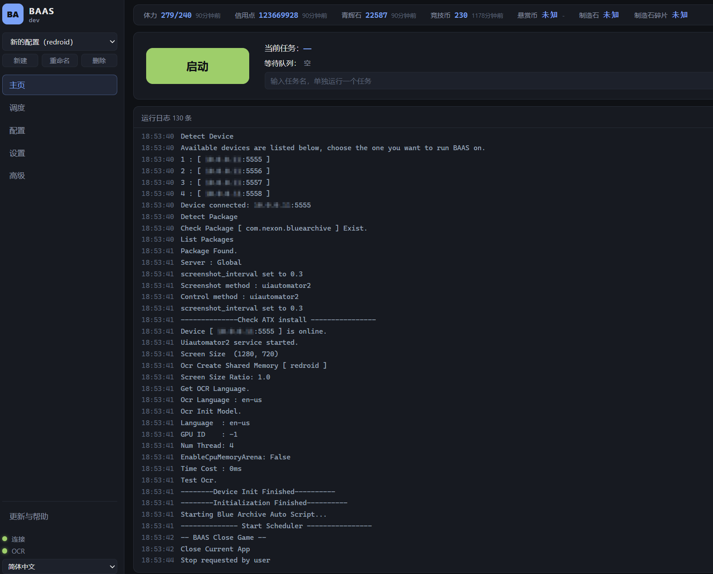
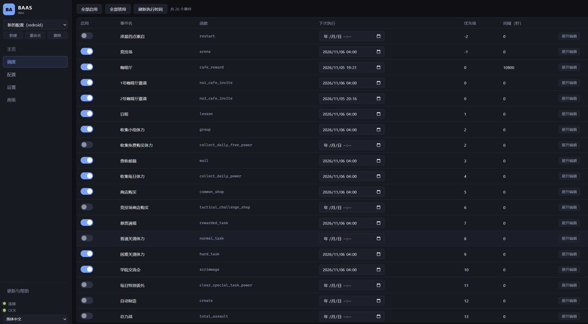

# YAB

**YAB**（Yet Another BAAS），一个带网页界面的蔚蓝档案脚本（全服支持），适用于 16:9 的游戏画面（1280x720 最佳）。Fork 自 [BAAS](https://github.com/pur1fying/blue_archive_auto_script), 受 [M9A](https://github.com/MAA1999/M9A) | [Alasio](https://github.com/LmeSzinc/Alasio) | [SRC](https://github.com/LmeSzinc/StarRailCopilot) | [zzz-od](https://github.com/OneDragon-Anything/ZenlessZoneZero-OneDragon) 启发。

当前网页界面：

**主页**：查看资产、当前任务和运行日志，也可以单独运行一个任务。



**调度**：启用任务，调整下次执行时间、优先级和执行间隔。



## 功能 Features
- **角色好感度**: 咖啡厅一日8摸, 日程自动找指定学生, 每日最大限度提升好感度
- **主线**: 自动推图(普通4-30，困难1-30，最新主线<30>已适配)
- **咖啡厅**: 邀请券可选择指定学生 咖啡厅摸头 咖啡厅奖励
- **商店**: 支持指定普通物品商店 以及竞技场商店自动购买和刷新次数
- **收获**: 每日小组体力 邮箱 竞技场每日领奖 总力战累计积分领奖 每日任务领奖 pass任务点数和奖励领取
- **体力清理**: 可指定任意主线关卡(普通困难) 特别委托 活动关卡 扫荡任意次数
- **日程**: 优先做指定角色存在的日程, 可优先做加好感度多的日程, 指定每个区域日程次数
- **竞技场**: 清理到没有竞技场挑战券为止，自动领取每日奖励
- **制造**: 无缝制造三解 指定制造优先级 次数 是否使用加速券
- **momotalk**: 自动完成所有未结束对话 完成剧情 领取青辉石
- **总力战**: 清空总力战挑战券并领取奖励(自动凹分功已在[该仓库](https://github.com/pur1fying/BAAS_Cpp)适配, 上游正在接入**BAAS**)
- **战术综合测试**: 在考试开启期间自动清票
- **剧情**: 一键清理主线剧情，小组剧情, 迷你剧情
- **活动**: 一键活动推剧情，任务，挑战，走格子(三服活动稳定更新)

### 突出特性：

- **16:9分辨率模拟器都可以运行，不局限于1280x720**
- **在低配电脑上运行也不会出现问题** 处理器速度低的电脑可以手动调小截图速度 增长运行时间
- **自定义调度(每日固定刷新时间，执行间隔)**

## 安装与启动

**请确保安装路径没有中文。** 网页模式在浏览器里操作；桌面应用会在独立窗口中显示相同界面。

### 使用安装包

桌面版提供 `YAB-<版本>-x64-setup.exe`（安装程序）和 `YAB-<版本>-x64.zip`（完整压缩包），内含独立运行环境、离线依赖、源码、网页和识别素材。安装后从快捷方式启动；压缩包解压后双击其中的 `YAB.exe`（桌面入口）。首次启动自动准备环境，不需要另装开发工具或联网下载依赖。关闭窗口会隐藏到系统托盘，需要结束程序时，右键托盘图标选择“退出”。自行构建的方法见下方“构建桌面安装包”。

更新时关闭程序，运行新版安装包或解压新版完整压缩包后启动即可。配置保存在 YAB.exe（桌面入口）旁的 config（配置目录）内，包含 profiles（任务配置）和 ocr（识别设置）。旧配置首次启动时自动复制迁移，原目录保留；覆盖安装始终保留配置，卸载时默认勾选“保留应用数据”，可取消以清理本地配置和默认应用数据。依赖未变时会复用环境，新版启动失败会保留并恢复上一版本。桌面版目前需要手动下载新包。

使用上游旧版启动器形式的下载包时，解压发布页或交流群中的下载包，双击 `BlueArchiveAutoScript.exe`（安装与启动程序），等待环境安装完成。程序会自动打开浏览器；没有自动打开的话，手动访问 [本机网页界面](http://127.0.0.1:22267) 就可以。

以后仍然通过这个程序启动。[安装相关文档](https://baas.wiki/usage_doc/install/choose_platform.html)中还有各平台的安装说明，旧版界面截图与当前网页可能不同。

### 使用源码

安装好 [uv（依赖管理工具）](https://docs.astral.sh/uv/getting-started/installation/) 后，在项目根目录打开终端，也就是能看到 `pyproject.toml`（项目依赖配置文件）的目录，运行：

```shell
uv sync --python 3.11
uv run python -m server --open
```

项目通过 `.python-version`（运行版本配置文件）默认使用 Python 3.11（运行环境），没有安装的话会自动下载。第一条命令安装项目依赖，第二条启动服务并打开浏览器。以后启动只需要运行第二条，项目依赖有变化时再运行第一条。

当前依赖适用于 Python 3.9–3.12（运行环境），请不要用 3.13 或更新版本启动。如果误用新版导致 `av`（视频解码库）编译失败，先将 `.venv`（项目虚拟环境目录）改名保留，再重新运行上面两条命令。

源码启动还需要准备 Node.js（网页构建运行环境）和 pnpm（前端依赖管理工具）。建议使用 22.12 以上的 22 系列或 24 以上版本的运行环境，包管理器版本可以按自己的开发环境选择，系统已有的 12 系列也可以使用。启动时会直接使用本机环境构建网页，首次需要联网下载前端依赖和 OCR（文字识别）服务，请耐心等待。完整发行包直接使用内置网页资源。

默认地址是 [本机网页界面](http://127.0.0.1:22267)。启动后请保持终端运行，关闭网页不会停止脚本。只想停任务，在主页点“停止”；要关闭整个服务，回到终端按 Ctrl+C（中断运行）。

### 从其他设备访问

默认只允许本机访问。如果想在同一网络的其他电脑或手机上打开网页，需要先设置访问密码，再启动远程监听。下面以 PowerShell（终端）为例，在项目根目录运行：

```powershell
$env:BAAS_WEBUI_TOKEN = Read-Host '设置网页访问密码' -MaskInput
uv run python -m server --host 0.0.0.0 --port 22267
```

`BAAS_WEBUI_TOKEN`（网页访问密码环境变量）在当前终端生效，换一个终端启动时需要重新设置。其他设备用运行脚本的电脑局域网地址和 22267 端口访问，再输入刚才设置的密码。密码不要写入项目文件或提交到仓库；无法连接时，也请检查防火墙是否允许这个端口。

设置密码后，本机也需要登录。当前为共享密码控制，登录后能修改配置、启动和停止任务，
没有只读角色或设备白名单。重启服务会清除登录会话。桌面应用默认只监听本机。

## 如何使用

1. 先准备好安卓设备，可以是真机、模拟器，也可以是 redroid（容器安卓设备）。将游戏画面设为 16:9（推荐 1280x720），并开启 ADB（安卓调试连接）。
2. 打开网页后，在左侧选择配置，也可以点“新建”为不同账号分别配置。默认配置可以修改，但不能删除。
3. 在“设置”的“游戏服务器与设备”里选好游戏服务器，再填写设备地址和端口，点击“连接设备”。“刷新设备列表”会列出已连接的安卓设备，点击即可选用；真机序列号也可以手动填写，端口留空。游戏服务器只决定游戏版本，不要求设备必须是模拟器。
4. 到“调度”勾选要运行的任务，按需要调整优先级、执行间隔和每日刷新时间。尚未整理成独立选项的设置，可以在“高级”里修改。
5. 等左下角 OCR（文字识别）指示灯变绿，再回到“主页”点“启动”。主页可以查看当前任务、等待队列和运行日志；要停止时点“停止”，等待当前运行结束。单独运行一个任务前，也需要先停止该配置的调度。

使用 redroid（容器安卓设备）时，地址和端口填写容器对外提供的调试连接地址，保持“启动时打开模拟器”关闭，不需要填写模拟器路径。截图和控制方式可以先选 adb（通用安卓调试方式），再按设备支持情况调整。只有需要脚本帮忙打开本机模拟器时，才配置“模拟器启动设置”。

详细配置和任务说明见[用户文档](https://baas.wiki/)。网页界面还在逐步完善，部分配置目前需要在“高级”中编辑。

## 如何上报bug How to Report Bugs
在提问题之前至少花费 5 分钟来思考和准备, 才会有人花费他的 5 分钟来帮助你。

在提问题前，请先：
- 检查 YAB 的更新，确认使用的是最新版；桌面版需要下载新版发行包，旧启动器按自身更新设置运行。
- 如果是非预期的行为，请提供非预期行为发生时UI界面的日志,模拟器截图或视频。

## 开发

日常使用按上面的源码启动方式就可以。修改网页时，可以把前后端分开启动。

前端使用 Vite 8（网页构建工具），环境要求和上面的源码启动相同，直接使用自己安装的运行环境和包管理器就可以。在项目根目录打开一个终端，启动后端：

```shell
uv run python -m server --api-only --port 8000
```

`--api-only`（仅启动后端）会跳过网页构建。再开一个终端，在项目根目录运行：

```shell
cd webapp
pnpm install --frozen-lockfile
pnpm dev
```

打开前端终端里显示的本机地址，页面会自动连接到 8000 端口的后端。本机开发时请使用未设置网页访问密码的终端，并保持前后端都在运行。

改完后，在项目根目录运行下面的命令，可以手动重新构建网页。之后再按正常方式启动服务，就能看到构建后的页面：

```shell
uv run python -m server.frontend --force
```

`--force`（强制重新构建）会重新生成网页资源。需要自行打包的话，安装器构建说明在 `deploy/installer`（安装器目录），完整程序的打包脚本在 `deploy/standalone`（独立发行包目录）；打包完整程序前请先构建网页。

### 构建桌面安装包

目前支持 Windows（视窗系统）64 位环境，使用 Electron（桌面应用框架）构建。先准备好上面提到的后端和前端工具；首次构建前，按“使用源码”启动一次，等左下角 OCR（文字识别）指示灯变绿，再回到终端按 Ctrl+C（中断运行）退出服务。

随后从项目根目录运行：

```powershell
uv sync --python 3.11
cd desktop
pnpm install --frozen-lockfile
pnpm run dist
```

这些命令会准备网页，将锁定的依赖构建成离线安装包，再复制源码、素材、独立解释器和 uv（环境管理工具），最后生成桌面安装包和完整压缩包，不再冻结后端。产物位于 `desktop/release/<构建时间>/`（发行目录），文件分别为 `YAB-<版本>-x64-setup.exe`（安装包）和 `YAB-<版本>-x64.zip`（完整压缩包）。

只需要解压运行目录时，将最后一条命令换成 `pnpm run pack`（构建应用目录）。构建中间文件保留在 `desktop/build`（构建缓存目录），每次发行产物放在新的时间目录中。更多运行与打包说明见 [desktop/README.md（桌面应用说明）](desktop/README.md)。
